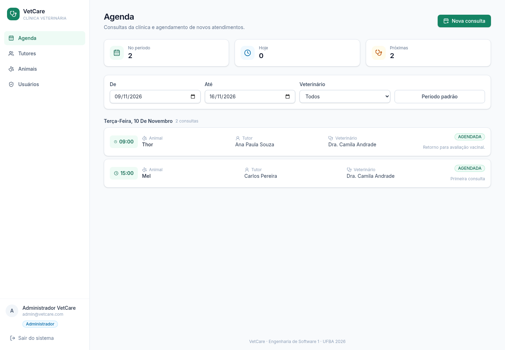

# VetCare

Sistema de gestão para clínicas veterinárias desenvolvido para a disciplina **Engenharia de Software 1** do Instituto de Computação da UFBA.

Esta é a **Sprint 5** do Trabalho II: 16/17 requisitos funcionais implementados, acrescidos do **Portal do Cliente** como extensão do escopo original.



## Escopo acumulado

| Requisito | Descrição | Prioridade | Situação |
|---|---|---|---|
| REQ01 | Manter Usuário (incluir, alterar, excluir e consultar) | Alta | Implementado |
| REQ02 | Autenticar Usuário com JWT e perfis de acesso | Alta | Implementado |
| REQ04 | Manter Tutor | Alta | Implementado |
| REQ05 | Manter Animal vinculado a um tutor | Alta | Implementado |
| REQ06 | Manter Veterinário com CRMV e especialidade | Alta | Implementado |
| REQ07 | Agendar Consulta com validação de conflito | Alta | Implementado |
| REQ08 | Cancelar Consulta liberando o horário | Alta | Implementado |
| REQ09 | Consultar Agenda por dia, semana e profissional | Alta | Implementado |
| REQ10 | Registrar Atendimento realizado pelo veterinário | Alta | Implementado |
| REQ11 | Manter Prontuário com histórico clínico do animal | Alta | Implementado |
| REQ12 | Registrar Vacinação com previsão da próxima dose | Média | Implementado |
| REQ13 | Emitir Prescrição vinculada ao atendimento | Média | Implementado |
| REQ14 | Registrar Pagamento de consultas e procedimentos | Alta | Implementado |
| REQ15 | Dashboard Financeiro por período | Média | Implementado |
| REQ16 | Notificar Tutor sobre consultas e vacinação | Média | Implementado |
| REQ17 | Gerar Relatórios Gerenciais | Média | Implementado |

**16 de 17 requisitos = 94,1%**, dentro da meta de aproximadamente 90%.

Fora do escopo: apenas REQ03 (recuperação de senha).

### Área médica do veterinário

O portal do veterinário foi ampliado para ser um espaço clínico:

- **Painel clínico:** consultas do dia, pacientes, vacinas a vencer e últimos atendimentos.
- **Meus pacientes:** apenas animais que já tiveram consulta com o veterinário logado, com última consulta, próxima vacina e acesso ao prontuário.
- **Prontuários:** lista dos atendimentos registrados pelo veterinário, com diagnóstico, prescrições e link para o histórico completo.
- O veterinário só acessa prontuário, vacinação e dados de animais que atendem; a API valida essa regra, não apenas a interface.
- **Cancelamento pelo veterinário:** o profissional pode cancelar as próprias consultas, com motivo e auditoria.
- **Bloqueio de dia de trabalho:** o veterinário bloqueia uma data com motivo (congresso, atestado, férias). As consultas agendadas no dia são canceladas, os horários são liberados e os tutores entram na fila de notificações. O dia pode ser desbloqueado depois.
- **Compartilhamento de prontuário:** o veterinário responsável gera um código de 8 caracteres, válido por 7 dias, e outro veterinário consulta o prontuário em modo somente leitura informando o código. O código pode ser regenerado ou revogado, e todo acesso é auditado.
- **Trilha de auditoria:** logins, acessos a prontuários, consultas de pacientes, relatórios, dashboards, compartilhamentos, tentativas negadas e códigos inválidos/expirados são gravados na tabela `auditoria`. Eventos de segurança usam transação independente para sobreviver a rollbacks. O Administrador consulta tudo em **Auditoria**, com filtros por período, ação e usuário.

### Extensão: Portal do Cliente

Além dos 17 requisitos, o cliente (tutor) possui um portal próprio com login por CPF e senha:

- consulta, cadastro e edição dos próprios pets;
- solicitação de agendamento com data/horário preferidos e motivo;
- acompanhamento do status do pedido (pendente, aprovado ou recusado);
- troca de senha no primeiro acesso.

A recepção recebe os pedidos em **Solicitações**, aprova escolhendo veterinário e horário — gerando
a consulta oficial — ou recusa com motivo. A decisão está na [ADR-16](docs/adr/ADR-16-portal-cliente.md).

## Portais por perfil

O login é único. Depois de autenticar, o sistema identifica o perfil e encaminha para o portal correspondente:

| Perfil | Portal | Visão |
|---|---|---|
| Administrador | `/portal/admin` | Indicadores da clínica, gestão de usuários, veterinários, tutores, animais e agenda |
| Recepcionista | `/portal/recepcao` | Agenda do dia, próximos 7 dias, cadastros e agendamento |
| Veterinário | `/portal/veterinario` | Apenas a própria agenda clínica, pacientes e horários |

As rotas também são protegidas no front-end e as permissões são revalidadas na API.


## Stack

- **Back-end:** Kotlin 2.3, Spring Boot 4.1, Spring Security (JWT), Spring Data JPA, Flyway, PostgreSQL, Redis, Springdoc OpenAPI
- **Front-end:** React 19, TypeScript, Vite, Tailwind CSS 4, React Router, React Hook Form + Zod, Axios
- **Infraestrutura:** Docker Compose (PostgreSQL 16 e Redis 7)
- **Testes:** JUnit 5 + MockMvc (back-end) e Vitest + Testing Library (front-end)

## Arquitetura

O sistema segue o estilo cliente-servidor com API REST organizada em camadas, conforme a Etapa 1:

```
backend/src/main/kotlin/br/ufba/vetcare/
├── api/              apresentação HTTP: controllers, DTOs e tratamento de erros
├── application/      casos de uso (serviços) e auditoria
├── domain/           entidades, enums e interfaces de repositório
└── infrastructure/   segurança (JWT), persistência e integrações
```

Decisões arquiteturais da Etapa 1 preservadas: JWT (ADR-03), PostgreSQL (ADR-04), auditoria dedicada (ADR-05), cache Redis para agenda (ADR-08) e health-check (ADR-09).

### Desvios registrados

- [ADR-01 a ADR-09 — decisões da Etapa 1](docs/adr/ADR-01-a-09-etapa-1.md)
- [ADR-10 — Veterinário representado por usuário com perfil](docs/adr/ADR-10-veterinario-como-usuario.md)
- [ADR-11 — API Gateway/BFF como camada de controllers no monólito](docs/adr/ADR-11-api-gateway-como-camada.md)
- [ADR-12 — Segredo JWT sem padrão e seed opt-in](docs/adr/ADR-12-segredo-jwt-e-seed.md)
- [ADR-13 — Atributos profissionais na entidade Usuário](docs/adr/ADR-13-atributos-profissionais-usuario.md)
- [ADR-14 — Atendimento como elo entre consulta, prontuário e prescrição](docs/adr/ADR-14-atendimento-prontuario.md)
- [ADR-15 — Notificações por caixa de saída com canal simulado](docs/adr/ADR-15-notificacoes-canal-simulado.md)
- [ADR-16 — Portal do cliente com autenticação por CPF](docs/adr/ADR-16-portal-cliente.md)
- [ADR-17 — Remoção de dados de demonstração e envio real por SMTP](docs/adr/ADR-17-remocao-de-mocks.md)

## Como rodar

### Pré-requisitos

- Docker e Docker Compose
- JDK 21+ (testado com JDK 27)
- Node.js 22.12+ (testado com Node 26)

### 1. Configurar o ambiente

```bash
cp .env.example .env
```

O Spring Boot importa esse `.env` automaticamente. Ele define o administrador inicial, a conexão
com o banco, o segredo JWT e as credenciais de SMTP. Não há seed nem contas de demonstração.

### 2. Subir banco e cache

```bash
docker compose up -d
```

Isso inicia PostgreSQL em `127.0.0.1:5432` (banco/usuário/senha: `vetcare`) e Redis em
`127.0.0.1:6379`. As portas ficam restritas à máquina local.

### 3. Subir o back-end

```bash
cd backend
./mvnw spring-boot:run
```

A API sobe em `http://localhost:8080`. O Flyway cria o esquema; se ainda não existir administrador
ativo, `ADMIN_EMAIL` e `ADMIN_PASSWORD` criam o primeiro acesso.

- Swagger UI: http://localhost:8080/swagger-ui.html
- Health-check: http://localhost:8080/actuator/health

### 4. Subir o front-end

```bash
cd frontend
npm install
npm run dev
```

Acesse `http://localhost:5173`.

### Primeiro acesso

Não existe seed. O **administrador inicial** é criado na primeira inicialização a partir de
`ADMIN_EMAIL`, `ADMIN_PASSWORD` (mínimo 8 caracteres) e `ADMIN_NOME` no `.env`. Depois disso, os
demais usuários, veterinários e tutores são cadastrados pelo próprio sistema.

O cliente não possui auto-cadastro: a recepção cadastra o tutor e define a senha do portal; no
primeiro acesso o cliente troca a senha.

### Variáveis de ambiente

O `.env` da raiz é carregado automaticamente. As principais:

| Variável | Padrão | Uso |
|---|---|---|
| `DB_URL` | `jdbc:postgresql://localhost:5432/vetcare` | Conexão com o PostgreSQL |
| `DB_USER` / `DB_PASSWORD` | `vetcare` / `vetcare` | Credenciais do banco |
| `REDIS_HOST` / `REDIS_PORT` | `localhost` / `6379` | Cache da agenda |
| `JWT_SECRET` | vazio | Assinatura dos tokens; vazio gera segredo aleatório por execução |
| `JWT_EXPIRATION_MINUTES` | `120` | Validade do token |
| `ADMIN_EMAIL` / `ADMIN_PASSWORD` | vazio | Administrador inicial criado no primeiro start |
| `ADMIN_NOME` | `Administrador` | Nome do administrador inicial |
| `MAIL_HOST` / `MAIL_PORT` | `localhost` / `25` | Servidor SMTP para notificações reais |
| `MAIL_USERNAME` / `MAIL_PASSWORD` | vazio | Autenticação SMTP |
| `MAIL_AUTH` / `MAIL_STARTTLS` | `false` | Configuração TLS/autenticação do SMTP |
| `MAIL_FROM` | `no-reply@vetcare.local` | Remetente dos avisos |
| `NOTIFICACOES_CANAL` | `SMTP` | Canal de envio das notificações |
| `CORS_ALLOWED_ORIGINS` | `http://localhost:5173` | Origens permitidas |

Em produção, defina `JWT_SECRET` com 32+ caracteres e credenciais SMTP reais em cofre/variável
gerenciada.

## Testes

```bash
# Back-end (84 testes de integração)
cd backend && ./mvnw test

# Front-end (10 testes)
cd frontend && npm test

# Build de produção do front-end
cd frontend && npm run build
```

Os testes de back-end cobrem autenticação (incluindo token adulterado), RBAC, CRUD de usuários,
tutores, animais e veterinários, auditoria, agendamento, conflito de horário (inclusive segundos no
mesmo minuto), vínculo animal/tutor, cancelamento com liberação do horário, cache da agenda,
atendimento, prontuário, prescrições, vacinação, pagamentos, notificações, relatórios, portal do
cliente e proteção do último administrador. Usam H2 em
memória no perfil `test`, sem exigir Docker.

## Segurança e auditoria

- Senhas armazenadas com BCrypt.
- Tokens JWT assinados com HMAC-SHA256, contendo perfil do usuário.
- `JWT_SECRET` não tem valor padrão: sem configuração, um segredo aleatório é gerado por execução.
- Não há seed nem contas padrão; o administrador inicial vem do `.env` e não é registrado em log.
- Autorização por perfil na borda da API:
  - **Administrador:** usuários, tutores, animais e agenda.
  - **Recepcionista:** tutores, animais e agendamento.
  - **Veterinário:** leitura de tutores/animais e apenas a própria agenda.
- Todas as mutações e tentativas de login são registradas na tabela `auditoria` com o e-mail do
  usuário autenticado, ação, entidade, IP e data/hora.
- Exclusões de usuários e animais são lógicas, preservando histórico e rastreabilidade.
- A agenda normaliza o horário para o minuto e possui índice único no banco por veterinário/horário,
  evitando conflitos inclusive em requisições concorrentes.
- Um administrador não pode desativar ou rebaixar a própria conta, e o sistema exige ao menos um
  administrador ativo.
- CRMV é único quando informado e o cadastro de veterinário exige o registro profissional.

## Principais endpoints

| Método | Rota | Perfis | Descrição |
|---|---|---|---|
| POST | `/api/auth/login` | público | Autenticação |
| GET | `/api/auth/me` | autenticados | Dados da sessão |
| GET/POST/PUT/DELETE | `/api/usuarios` | Administrador | REQ01 |
| GET/POST/PUT/DELETE | `/api/tutores` | Admin/Recepção (escrita) | REQ04 |
| GET/POST/PUT/DELETE | `/api/animais` | Admin/Recepção (escrita) | REQ05 |
| GET/POST/PUT/DELETE | `/api/veterinarios` | Admin (escrita) | REQ06 |
| GET | `/api/animais/por-tutor/{id}` | autenticados | Apoio ao agendamento |
| GET | `/api/consultas` | autenticados | Agenda por período/profissional (REQ09) |
| POST | `/api/consultas` | Admin/Recepção | REQ07 |
| POST | `/api/consultas/{id}/cancelar` | Admin/Recepção | REQ08 |
| POST | `/api/consultas/{id}/atendimento` | Admin/Veterinário | REQ10 e REQ13 |
| GET | `/api/animais/{id}/prontuario` | autenticados | REQ11 |
| GET/POST | `/api/animais/{id}/vacinacoes` | equipe | REQ12 |
| DELETE | `/api/vacinacoes/{id}` | Admin/Veterinário | REQ12 |
| GET/POST | `/api/pagamentos` | Admin/Recepção | REQ14 |
| GET | `/api/financeiro/dashboard` | Admin/Recepção | REQ15 |
| GET/POST | `/api/notificacoes` e `/processar` | Admin/Recepção | REQ16 |
| GET | `/api/relatorios/resumo` | Admin/Recepção | REQ17 |
| POST | `/api/cliente/auth/login` | Público | Login do cliente por CPF (extensão) |
| GET/POST/PUT | `/api/cliente/pets` | Cliente | Pets do próprio tutor (extensão) |
| GET/POST | `/api/cliente/solicitacoes` | Cliente | Pedidos de agendamento (extensão) |
| GET/POST | `/api/solicitacoes` e `/aprovar`/`/recusar` | Admin/Recepção | Análise dos pedidos (extensão) |
| GET | `/api/veterinarios/me/pacientes` | Veterinário | Meus pacientes (extensão clínica) |
| GET | `/api/veterinarios/me/atendimentos` | Veterinário | Atendimentos registrados por mim |
| POST/DELETE | `/api/animais/{id}/compartilhamento` | Veterinário | Gera/revoga código do prontuário |
| GET | `/api/prontuarios/compartilhados/{codigo}` | Veterinário | Prontuário compartilhado (somente leitura) |
| GET | `/api/auditoria` | Administrador | Consulta da trilha de auditoria |
| GET/POST/DELETE | `/api/veterinarios/me/bloqueios` | Veterinário | Bloqueio de dia de trabalho |

A documentação interativa completa está no Swagger UI.

## Estrutura do repositório

```
vetcare/
├── backend/            API Spring Boot em Kotlin
├── frontend/           SPA React
├── docs/
│   ├── adr/            decisões arquiteturais
│   ├── relatorio/      relatório da sprint (HTML/PDF)
│   └── slides/         apresentação (PPTX)
├── docker-compose.yml  PostgreSQL + Redis
└── README.md
```

## Documentos

> Os relatórios e apresentações das sprints anteriores registram o ambiente de demonstração da época.
> A versão atual não possui seed nem contas padrão: o administrador inicial vem do `.env`.

- [Relatório da Sprint 5 (PDF)](docs/relatorio/relatorio-sprint-5.pdf)
- [Apresentação da Sprint 5 (PPTX)](docs/slides/VetCare-Sprint-5.pptx)
- [Relatório da Sprint 4 (PDF)](docs/relatorio/relatorio-sprint-4.pdf)
- [Apresentação da Sprint 4 (PPTX)](docs/slides/VetCare-Sprint-4.pptx)
- [Relatório da Sprint 3 (PDF)](docs/relatorio/relatorio-sprint-3.pdf)
- [Apresentação da Sprint 3 (PPTX)](docs/slides/VetCare-Sprint-3.pptx)
- [Relatório da Sprint 2 (PDF)](docs/relatorio/relatorio-sprint-2.pdf)
- [Apresentação da Sprint 2 (PPTX)](docs/slides/VetCare-Sprint-2.pptx)
- [Relatório da Sprint 1 (PDF)](docs/relatorio/relatorio-sprint-1.pdf)
- [Apresentação da Sprint 1 (PPTX)](docs/slides/VetCare-Sprint-1.pptx)
- [ADRs](docs/adr)
- [Capturas de tela](docs/relatorio/img)

## Publicar no GitHub

O repositório local já está inicializado e commitado na branch `main`. Para publicar:

1. Crie um repositório **público vazio** chamado `vetcare` no GitHub (sem README nem `.gitignore`).
2. No diretório do projeto, conecte o remoto e envie:

```bash
git remote add origin https://github.com/SEU-USUARIO/vetcare.git
git push -u origin main
```

O workflow em `.github/workflows/ci.yml` executa os testes do back-end e do front-end a cada push.

## Equipe

- Vitor de Jesus Santos — UFBA

Disciplina: Engenharia de Software 1 · Prof.ª Dra. Larissa Barbosa Leôncio Pinheiro
